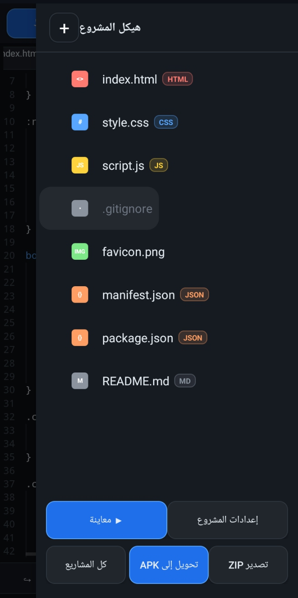
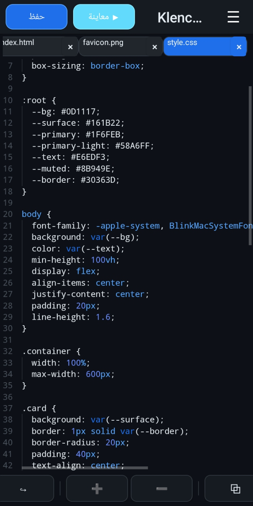

# Klencod Web

### A Powerful Web Development Environment for Android

Build, edit, preview, and turn web projects into standalone Android applications — directly from your Android device.

[**Download the latest release**](../../releases/latest) · [**View all releases**](../../releases) · [**Report a problem**](../../issues)

---

## Overview

**Klencod Web** brings essential web development tools together in one Android application. It provides a workspace for managing web projects, editing source files, previewing pages, inspecting elements, and packaging supported web projects as Android APKs.

Whether you are experimenting with a web idea or building a complete project, Klencod Web helps you work through the development process from your Android device.

## Screenshots

### Project Management

### Code Editor

## Key Features

- **Code Editing** — Work with web project files in an integrated code-editing environment.
- **Visual Inspector** — Select visible page elements and adjust CSS properties through the visual preview.
- **Live Preview** — Preview your web pages while developing.
- **Project Management** — Create, organize, import, and export projects and their files.
- **Web-to-APK Builder** — Package supported HTML, CSS, and JavaScript projects as standalone Android APKs.
- **APK Customization** — Configure the application name, icon, splash screen, and requested Android permissions.
- **File and Tab Management** — Navigate project files and work across multiple editor tabs.
- **Search and Replace** — Find and update text in project files.
- **Editor Themes** — Customize the editor appearance.

## Web-to-APK

Klencod Web includes a builder for packaging supported web projects into Android applications.

The builder provides options to customize:
- Application name
- Application icon
- Splash screen
- Android permissions

The generated APK can be signed for installation on an Android device. Compatibility depends on the structure and requirements of the web project.

## Download

Get Klencod Web from the project's GitHub Releases page:

[**Download the latest APK**](../../releases/latest)

[Browse all versions](../../releases)

Each release contains its own version information and downloadable files. Check the release notes for details about changes in each version.

## Documentation

- [Features](docs/FEATURES.md)
- [Installation](docs/INSTALLATION.md)
- [Changelog](CHANGELOG.md)

## Support and Feedback

Found a problem or have an idea for an improvement? Please use the repository's [Issues](../../issues) page to report it or share your suggestion.

When reporting a problem, include:
- The Klencod Web version you are using
- Your Android version and device model
- The steps needed to reproduce the issue
- Screenshots or logs, when relevant

## Project Updates

Follow the [Releases](../../releases) page to keep track of new versions, improvements, and fixes.

---

**Klencod Web — Create. Edit. Preview. Build.**

Thank you for using Klencod!

